<picture><source media="(max-width: 600px)" srcset="assets/hero-mobile.svg"><source media="(prefers-color-scheme: dark)" srcset="assets/hero-dark.svg">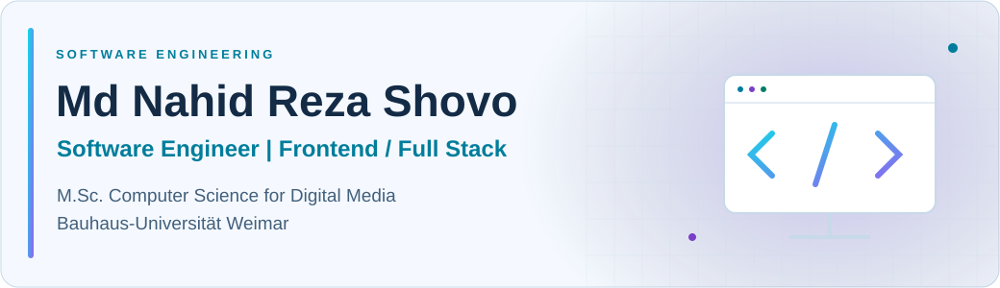</picture>

  

# About Me

Software engineer with 4+ years of professional software engineering experience, currently pursuing an M.Sc. in Computer Science for Digital Media at Bauhaus-Universität Weimar. My professional work spans Svelte/SvelteKit interfaces, Electron desktop applications, Hapi APIs and Java/Spring Boot systems.

I am seeking working student roles in software engineering, frontend/full-stack development and AI-assisted development.

<picture><source media="(prefers-color-scheme: dark)" srcset="assets/highlight-years-dark.svg"></picture> <picture><source media="(prefers-color-scheme: dark)" srcset="assets/highlight-projects-dark.svg">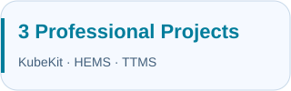</picture> <picture><source media="(prefers-color-scheme: dark)" srcset="assets/highlight-growth-dark.svg"></picture>

## Technical Skills

<table>
<tr><th>Category</th><th>Technologies</th></tr>
<tr><td><strong>Programming Languages</strong></td><td> TypeScript &nbsp;  JavaScript &nbsp;  Java &nbsp;  Python &nbsp;  C &nbsp;  C++ &nbsp;  PHP &nbsp;  C#</td></tr>
<tr><td><strong>Frontend</strong></td><td> React &nbsp;  Svelte/SvelteKit &nbsp;  HTML &nbsp;  CSS &nbsp;  Tailwind CSS &nbsp;  Bootstrap</td></tr>
<tr><td><strong>Backend &amp; Frameworks</strong></td><td> Spring &nbsp;  Spring Boot &nbsp;  JPA &nbsp;  Hibernate &nbsp;  Hapi &nbsp;  Express &nbsp;  Flask &nbsp;  Laravel</td></tr>
<tr><td><strong>Databases</strong></td><td><strong>Relational:</strong>  PostgreSQL &nbsp;  MySQL &nbsp;  Supabase <strong>NoSQL:</strong>  MongoDB &nbsp;  PouchDB &nbsp;  Cassandra <strong>Search:</strong>  Elasticsearch</td></tr>
<tr><td><strong>Development, Infrastructure &amp; Other Tools</strong></td><td> Git &nbsp;  Docker &nbsp;  Kubernetes &nbsp;  Ansible &nbsp;  Jenkins &nbsp;  Nx &nbsp;  Electron &nbsp;  Android SDK &nbsp;  Unity &nbsp;  Shell Scripting &nbsp;  LaTeX</td></tr>
<tr><td><strong>AI Tools</strong></td><td> OpenAI Codex &nbsp;  Claude &nbsp;  ChatGPT</td></tr>
</table>

**Languages:** English (fluent), German (basic).

## Professional Experience

<a href="https://www.dsinnovators.com/"><picture><source media="(max-width: 600px)" srcset="assets/employment-mobile.svg"><source media="(prefers-color-scheme: dark)" srcset="assets/employment-dark.svg"></picture></a>

### Professional Projects

The following projects were undertaken during my employment at Dynamic Solution Innovators Ltd. Employer project source code is not included in my public portfolio.

<table width="100%"><tr><td><a href="https://kubekit.io/"><picture><source media="(max-width: 600px)" srcset="assets/professional-kubekit-mobile.svg">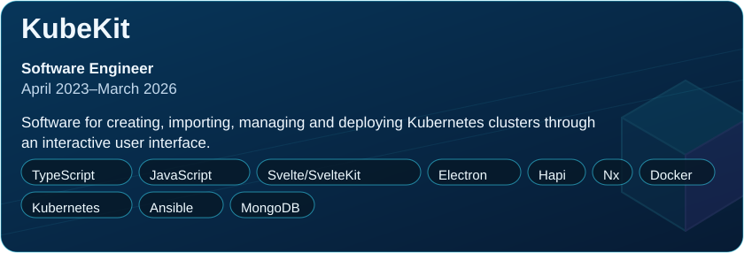</picture></a>

View responsibilities

<strong>KubeKit</strong> · Software Engineer · April 2023–March 2026

Software for creating, importing, managing and deploying Kubernetes clusters through an interactive user interface.

<strong>Technologies:</strong> TypeScript, JavaScript, Svelte/SvelteKit, Electron, Hapi, Nx, Docker, Kubernetes, Ansible, MongoDB.
<ul><li>Collaborated in a three-person development team.</li><li>Developed the Svelte/SvelteKit user interface, Electron desktop application and Hapi.js APIs.</li><li>Contributed to the marketing website using HTML and JavaScript.</li></ul>
</td></tr></table>

<table width="100%"><tr><td width="48%" valign="top"><a href="https://hems.alhaiatululya.org/"><picture><source media="(max-width: 600px)" srcset="assets/professional-hems-mobile.svg">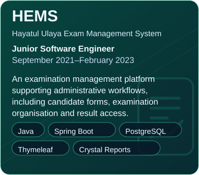</picture></a>

View responsibilities

<strong>HEMS — Hayatul Ulaya Exam Management System</strong> · Junior Software Engineer · September 2021–February 2023

An examination management platform supporting administrative workflows, including candidate forms, examination organisation and result access.

<strong>Technologies:</strong> Java, Spring Boot, PostgreSQL, Thymeleaf, Crystal Reports.
<ul><li>Implemented form submission, roll number and top sheet generation, seat planning and result search.</li><li>Developed user interfaces and APIs.</li><li>Generated more than 50 Crystal Reports.</li><li>Contributed to registration, examination centre management and payment-related functionality.</li></ul>
</td><td width="4%" aria-hidden="true">&nbsp;</td><td width="48%" valign="top"><a href="https://ipemis.dpe.gov.bd/"><picture><source media="(max-width: 600px)" srcset="assets/professional-ttms-mobile.svg">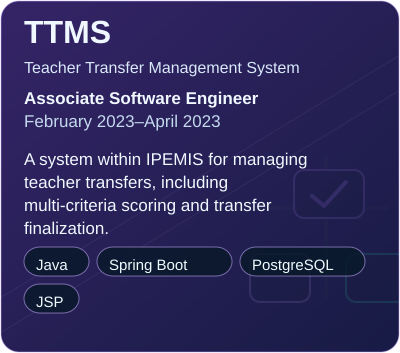</picture></a>

View responsibilities

<strong>TTMS — Teacher Transfer Management System</strong> · Associate Software Engineer · February 2023–April 2023

A system within IPEMIS for managing teacher transfers, including multi-criteria scoring and transfer finalization.

<strong>Technologies:</strong> Java, Spring Boot, PostgreSQL, JSP.
<ul><li>Combined multi-criteria scoring, school-wise sorting and database storage in a single request.</li><li>Achieved a 5× speed improvement in transfer finalization.</li></ul>
</td></tr></table>

## Public Projects

Public projects are distinct from my employment work. Card artwork is decorative, not an application screenshot.

<table width="100%"><tr><td width="48%" valign="top"><a href="https://github.com/NahidReza08/DockerBlocks"><picture><source media="(max-width: 600px)" srcset="assets/public-dockerblocks-mobile.svg"><source media="(prefers-color-scheme: dark)" srcset="assets/public-dockerblocks-dark.svg">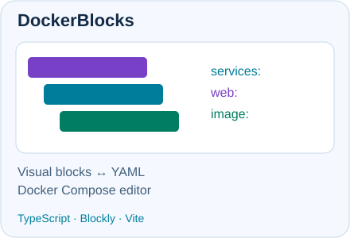</picture></a></td><td width="4%" aria-hidden="true">&nbsp;</td><td width="48%" valign="top"><a href="https://github.com/NahidReza08/IAOR-Group-29-Handwritten-Character-Classification"><picture><source media="(max-width: 600px)" srcset="assets/public-classification-mobile.svg"><source media="(prefers-color-scheme: dark)" srcset="assets/public-classification-dark.svg">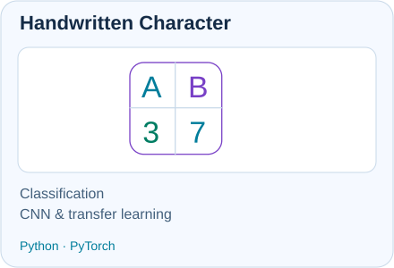</picture></a></td></tr></table>

<table width="100%"><tr><td width="48%" valign="top"><a href="https://github.com/NahidReza08/e-commerce-with-redux"><picture><source media="(max-width: 600px)" srcset="assets/public-storefront-mobile.svg"><source media="(prefers-color-scheme: dark)" srcset="assets/public-storefront-dark.svg">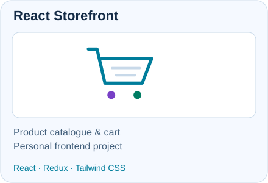</picture></a></td><td width="4%" aria-hidden="true">&nbsp;</td><td width="48%" valign="top"><a href="https://github.com/NahidReza08/Todos-App"><picture><source media="(max-width: 600px)" srcset="assets/public-todo-mobile.svg"><source media="(prefers-color-scheme: dark)" srcset="assets/public-todo-dark.svg">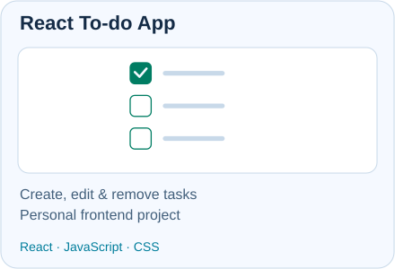</picture></a></td></tr></table>

<table width="100%"><tr><td width="48%" valign="top"><a href="https://github.com/NahidReza08/AVOID-THE-PIEDRA"><picture><source media="(max-width: 600px)" srcset="assets/public-piedra-mobile.svg"><source media="(prefers-color-scheme: dark)" srcset="assets/public-piedra-dark.svg">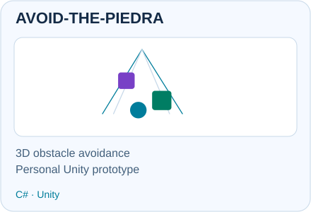</picture></a></td><td width="4%" aria-hidden="true">&nbsp;</td><td width="48%" valign="top"><a href="https://github.com/NahidReza08/Real-Time-Face-Mask-Detection/tree/master"><picture><source media="(max-width: 600px)" srcset="assets/public-facemask-mobile.svg"><source media="(prefers-color-scheme: dark)" srcset="assets/public-facemask-dark.svg">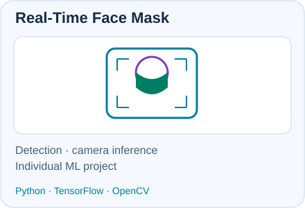</picture></a></td></tr></table>

<strong>DockerBlocks</strong> — context, contribution and technologies

[DockerBlocks](https://github.com/NahidReza08/DockerBlocks) — University project for editing Docker Compose configurations visually. I implemented conversion from blocks to YAML and back, within a supported Compose subset. The repository credits its upstream ideas and early code.

**Technologies:** TypeScript, Blockly, YAML, Vite.

<strong>Handwritten Character Classification</strong> — context, contribution and technologies

[Handwritten Character Classification](https://github.com/NahidReza08/IAOR-Group-29-Handwritten-Character-Classification) — Individually implemented university coursework on classifying handwritten letters and digits, comparing CNN architectures and transfer learning. Originally submitted under the Group 29 course identifier.

**Technologies:** Python, PyTorch, torchvision.

<strong>React Storefront</strong> — context, contribution and technologies

[React Storefront](https://github.com/NahidReza08/e-commerce-with-redux) — Personal frontend project for browsing products and managing a cart, with Redux state, API fetching and a demonstration checkout interface.

**Technologies:** JavaScript, React, Redux, React Router, Axios, Tailwind CSS.

<strong>React To-do App</strong> — context, contribution and technologies

[React To-do App](https://github.com/NahidReza08/Todos-App) — Personal project for creating, editing and removing to-do entries using React component state.

**Technologies:** JavaScript, React, CSS.

<strong>AVOID-THE-PIEDRA</strong> — context, contribution and technologies

[AVOID-THE-PIEDRA](https://github.com/NahidReza08/AVOID-THE-PIEDRA) — Personal Unity 3D obstacle-avoidance game exploring interactive gameplay and touch-based player controls, with automatic forward movement and distance-based scoring.

**Technologies:** C#, Unity.

<strong>Real-Time Face Mask Detection</strong> — context, components and attribution

[Implementation on master](https://github.com/NahidReza08/Real-Time-Face-Mask-Detection/tree/master). My individual project detects whether a person is wearing a mask in a camera stream. The notebooks implement training with ImageNet-pretrained MobileNetV2 and camera inference with OpenCV, a bundled Caffe face detector, and mask/no-mask labels.

**Technologies:** Python, TensorFlow/Keras, OpenCV, NumPy, imutils and scikit-learn. Pretrained models are third-party components; their original authorship is not claimed. Dataset provenance and additional upstream credits are not fully documented in the repository. No deployment or accuracy claim is made here.

## GitHub Activity

<picture><source media="(max-width: 600px)" srcset="assets/activity-mobile-dark.svg"><source media="(prefers-color-scheme: dark)" srcset="assets/activity-dark.svg">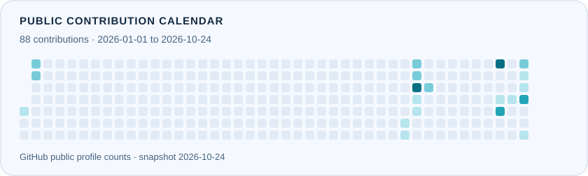</picture>

<picture><source media="(prefers-color-scheme: dark)" srcset="assets/trend-dark.svg">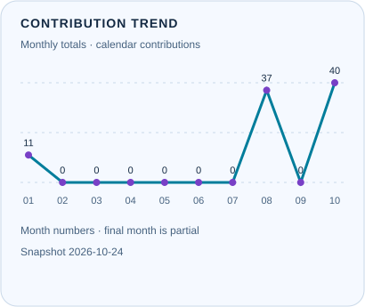</picture> <picture><source media="(prefers-color-scheme: dark)" srcset="assets/languages-dark.svg">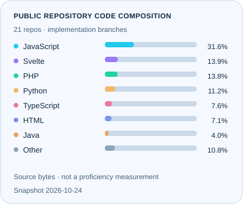</picture>

**Snapshot: 24 October 2026.** The calendar shows publicly visible GitHub profile contributions for 2026 through the snapshot date; these are not public commit counts alone. Code composition measures programming/markup source bytes on one selected implementation-bearing branch per non-fork public repository, excluding dependencies, generated code and notebook outputs. Java is shown separately. This is not a proficiency measurement. [Data sources and refresh method](docs/DATA.md).

## Publication

<a href="https://dl.acm.org/doi/abs/10.1145/3447535.3462508"><picture><source media="(max-width: 600px)" srcset="assets/publication-mobile.svg"><source media="(prefers-color-scheme: dark)" srcset="assets/publication-dark.svg">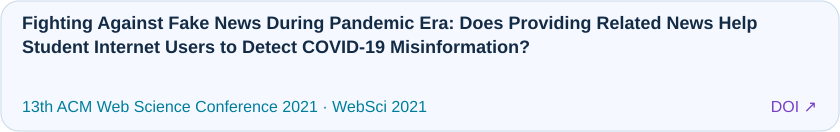</picture></a>

## Education

<table width="100%"><tr><td width="48%" valign="top"><a href="https://www.uni-weimar.de/en/"><picture><source media="(max-width: 600px)" srcset="assets/education-weimar-mobile.svg"><source media="(prefers-color-scheme: dark)" srcset="assets/education-weimar-dark.svg">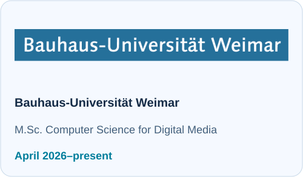</picture></a></td><td width="4%" aria-hidden="true">&nbsp;</td><td width="48%" valign="top"><a href="https://www.sust.edu/"><picture><source media="(max-width: 600px)" srcset="assets/education-sust-mobile.svg"><source media="(prefers-color-scheme: dark)" srcset="assets/education-sust-dark.svg">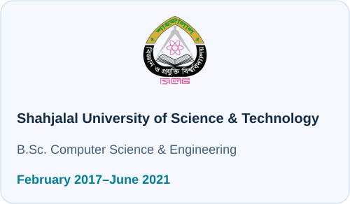</picture></a></td></tr></table>

## Certificates

### Course certificates

-  [**Machine Learning Foundations: A Case Study Approach**](https://www.coursera.org/account/accomplishments/verify/H8NRY826QG8B) — Coursera verification.
-  [**Docker Training Course for the Absolute Beginner**](https://learn.kodekloud.com/user/certificate/2D11FB482B52-2D11F543A456-2D11F5151AAA) — KodeKloud verification.

### Competitive-programming participation

-  [**Online Pre-Elimination Round at SnackDown 2019**](https://www.codechef.com/certificates/public/a9f0834) — CodeChef certificate.

## Coding, Achievements & Community

- 🧩 Solved approximately **1,000 programming problems** across programming platforms.
- 🏁 Participated in **46+ Codeforces contests**, **7+ CodeChef contests**, and **ICPC regional preliminary contests**.
- 🥉 **Second runners-up, SUST TECHFEST Hackathon 2019:** our team **TechExpo** developed **ECHO**, an Android application supporting communication for people with speech and hearing impairments, competing against more than 40 university teams.
- 🤝 Helped organise departmental events, including the **CSE Festival**, **SUST Techfest** and **CSE Silver Jubilee**.

## Interests

Areas I am interested in exploring; these are not proficiency claims.

<picture><source media="(prefers-color-scheme: dark)" srcset="assets/interest-0-dark.svg"></picture> <picture><source media="(prefers-color-scheme: dark)" srcset="assets/interest-1-dark.svg"></picture> <picture><source media="(prefers-color-scheme: dark)" srcset="assets/interest-2-dark.svg"></picture> <picture><source media="(prefers-color-scheme: dark)" srcset="assets/interest-3-dark.svg"></picture> <picture><source media="(prefers-color-scheme: dark)" srcset="assets/interest-4-dark.svg"></picture> <picture><source media="(prefers-color-scheme: dark)" srcset="assets/interest-5-dark.svg"></picture> <picture><source media="(prefers-color-scheme: dark)" srcset="assets/interest-6-dark.svg"></picture> <picture><source media="(prefers-color-scheme: dark)" srcset="assets/interest-7-dark.svg"></picture> <picture><source media="(prefers-color-scheme: dark)" srcset="assets/interest-8-dark.svg"></picture> <picture><source media="(prefers-color-scheme: dark)" srcset="assets/interest-9-dark.svg"></picture>
